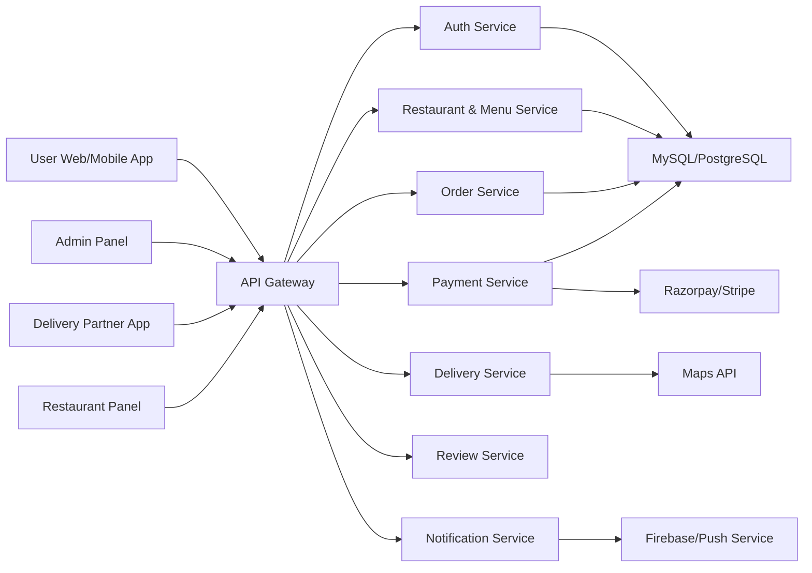
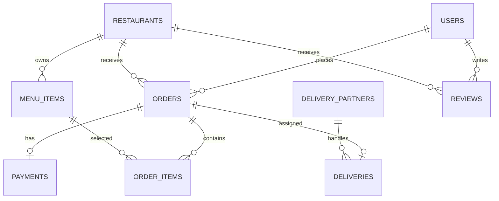
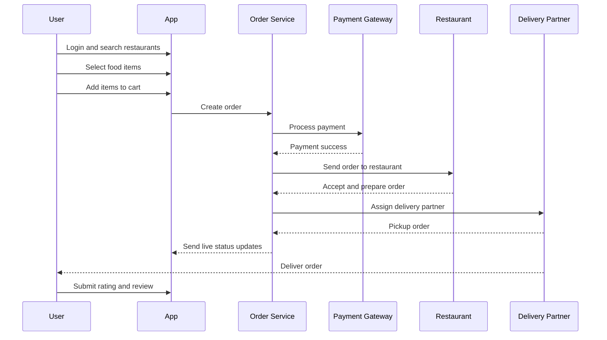

# Zomato Application - Complete Overview

This document explains the product idea, major modules, system design, database model, and possible future enhancements for a Zomato-like food delivery and restaurant discovery application.

## 1. Introduction

Zomato is a food delivery and restaurant discovery platform that allows users to search restaurants, order food online, reserve tables, read or write reviews, and track deliveries in real time.

Founded in 2008, Zomato became a large-scale consumer platform by combining restaurant discovery, online ordering, logistics, payments, ratings, offers, and recommendation systems.

For this project, the implementation uses the name **Zestora** and recreates the core food-delivery product experience without using Zomato brand assets.

## 2. Problem Statement

Traditional food ordering often includes manual phone calls, limited restaurant options, no live tracking, unclear pricing, and little visibility into ratings or customer feedback.

The application solves this by putting the complete ordering journey into one digital platform:

- Restaurant search and filtering
- Menu browsing
- Cart and checkout
- Order status tracking
- Reviews, offers, and analytics

## 3. High-Level Architecture

The real-world version of this system can be designed as a microservices-based architecture.



### Architecture Type

- Microservices architecture for large-scale production
- Modular frontend for user, restaurant, delivery, and admin roles
- REST APIs for communication between clients and backend services
- Relational database for core transactional data
- Optional NoSQL storage for logs, reviews, events, and analytics

## 4. Main System Components

### Frontend

- User app: restaurant search, menu browsing, cart, checkout, tracking
- Restaurant panel: menu, orders, pricing, offers, preparation status
- Delivery partner module: order assignment, pickup, navigation, earnings
- Admin panel: users, restaurants, transactions, complaints, reports

### Backend

- Auth APIs for login, JWT, OTP, and role-based access
- Restaurant APIs for listings, search, filters, and menu
- Order APIs for cart conversion, order status, and order history
- Payment APIs for gateway integration and payment verification
- Delivery APIs for partner assignment and tracking
- Review APIs for ratings, comments, and moderation

### Database

- SQL database such as MySQL or PostgreSQL for users, restaurants, menu, orders, payments, and delivery
- MongoDB or analytics storage can be added for unstructured events, activity logs, recommendation data, or customer behavior records

### Cloud and Integrations

- AWS, GCP, or Azure for hosting
- Firebase for push notifications and OTP workflows
- Google Maps API for distance, routing, and live delivery tracking
- Razorpay, Stripe, or similar payment gateways for online payments

## 5. Key Features

### User Features

- User registration and login
- Restaurant search based on location
- Filters by cuisine, rating, delivery time, price, and veg/non-veg preference
- Menu browsing
- Add to cart and checkout
- Coupon and offer support
- Live order tracking
- Ratings and reviews
- Order history

### Restaurant Panel Features

- Menu item management
- Price and availability updates
- Discount and offer management
- Incoming order management
- Accept/reject orders
- Preparation status updates
- Sales and performance analytics

### Delivery Partner Features

- Accept or reject assigned orders
- Pickup and drop status updates
- Map navigation support
- Delivery earnings tracking
- Order history

### Admin Panel Features

- Manage users
- Manage restaurants
- Manage delivery partners
- Monitor orders and transactions
- Handle complaints
- View reports and analytics
- Moderate reviews

## 6. Database Design

The simplified database uses these main tables:

- `users`
- `restaurants`
- `menu_items`
- `orders`
- `order_items`
- `delivery_partners`
- `deliveries`
- `reviews`
- `coupons`
- `payments`

A SQL implementation is included in [database/schema.sql](../database/schema.sql).



## 7. Order Workflow



## 8. Technologies Used

### Suggested Production Stack

- Frontend web: React.js
- Mobile app: Android with Java/Kotlin or React Native
- Backend: Spring Boot or Node.js
- Database: MySQL/PostgreSQL
- Authentication: JWT and OTP
- APIs: REST APIs
- Maps: Google Maps API
- Payments: Razorpay or Stripe
- Notifications: Firebase Cloud Messaging

### Current Project Stack

- HTML
- CSS
- JavaScript
- Local mock data in `app.js`
- Browser `localStorage` for cart, profile, favorites, and orders

## 9. Security Features

- JWT authentication for API requests
- Password hashing for credential storage
- HTTPS for client-server communication
- Role-based access control for user, admin, restaurant, and delivery partner
- Payment gateway tokenization
- Input validation and API rate limiting
- Secure handling of OTP and session expiration

## 10. Advanced Features

- AI-based restaurant and dish recommendations
- Dynamic pricing and surge delivery fees
- Live GPS tracking for delivery partners
- Push notifications for order updates
- In-app chat between customer and delivery partner
- Order prediction using historical demand data
- Restaurant demand forecasting
- Personalized offers and coupon targeting

## 11. Advantages

- Faster food ordering process
- Wider restaurant choice
- Transparent pricing and offers
- Real-time delivery status
- Digital payment support
- Better customer feedback loop
- Business analytics for restaurants and admins

## 12. Limitations

- Requires internet connectivity
- Delivery delays can happen due to traffic or restaurant load
- Restaurants may face commission charges
- Live tracking depends on GPS accuracy
- Payment failures require strong retry and refund handling

## 13. Future Enhancements

- Voice-based ordering
- AI-powered meal suggestions
- Subscription plans
- Drone or autonomous delivery experiments
- Loyalty program
- Group ordering
- Table reservation module
- Multi-city support

## 14. Project Implementation Plan

A complete portfolio-level version can be split into these modules:

```text
/backend
  /controllers
  /services
  /dao
  /models

/frontend
  /components
  /pages

/database
  schema.sql
```

Recommended full-stack learning path:

- Frontend: React + Bootstrap or Tailwind
- Backend: Spring Boot
- Database: MySQL
- Auth: JWT
- Deployment: Render, Railway, Vercel, Netlify, or AWS

## 15. Current Implementation Mapping

The current Zestora frontend already demonstrates these product concepts:

- Restaurant search and filters
- Menu browsing
- Add to cart and checkout
- Saved favorites
- Address and profile forms
- Order tracking
- Restaurant operations dashboard
- Responsive desktop and mobile UI

The next technical step would be replacing local mock data with backend APIs and a database.

## 16. Conclusion

A Zomato-like application is a strong final-year or portfolio project because it combines mobile/web UI, backend APIs, authentication, database design, payments, maps, real-time tracking, analytics, and role-based dashboards.

The project can start as a frontend prototype and grow into a complete full-stack platform with Spring Boot, MySQL, JWT authentication, and real service integrations.
